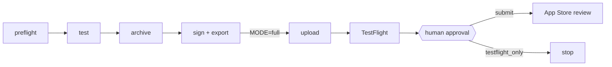

# iOS Release Pipeline

One command takes an Xcode project from source to TestFlight, then waits for a human to approve App Store submission. Built for a solo developer shipping many small iOS apps from one Mac, with no Fastlane and no registered devices.

```sh
release ~/Developer/MyApp              # build, sign, upload to TestFlight, then wait for approval
release ~/Developer/MyApp build_only   # stop at a signed .ipa; nothing is sent to Apple
```

## What it does

Each release runs as a [Dagu](https://github.com/dagu-org/dagu) DAG, so every stage has its own log, retries independently, and can be resumed from the step that failed.



## Features

- **Project discovery.** Finds the `.xcworkspace` or `.xcodeproj` (also under `ios/` for React Native/Expo), picks the scheme, and reads bundle ID and `MARKETING_VERSION` from the Release build settings.
- **Build numbers that never collide.** Queries App Store Connect for every build ever uploaded for the app and uses one above the highest.
- **Tests when they exist.** Runs the scheme's tests on the newest available iPhone simulator; skips cleanly when the scheme has no test targets.
- **Signing without Xcode's automatic signing.** Archives unsigned, then creates or reuses an App Store provisioning profile per bundle (app, widgets, App Clip, watch app) through the App Store Connect API, registering missing bundle IDs on the way.
- **Throwaway keychain.** The distribution certificate is imported into a temporary keychain that is always removed from the search list on exit, so a failed run never leaves a keychain that breaks later signing.
- **Entitlements restored after export.** Exporting an unsigned archive strips every entitlement. `resign.py` puts each target's entitlements back, keeps only what its profile grants (and logs what it dropped), adds `on-demand-install-capable` for App Clips, and re-signs deepest bundles first.
- **TestFlight hand-off.** Uploads with `altool` (skips if the build is already there), waits for processing, clears export compliance, adds the build to the internal group, and posts a macOS notification.
- **Human gate before review.** A Dagu `human.task` asks whether to submit. On approval it creates or reuses the App Store version, attaches the build, sets "What's New", cancels a rejected submission that is holding the version, and submits for review.
- **Submission allowlist.** App Store submission is refused for any bundle ID not listed in `owned-apps.txt`. Client apps should ship from the client's own Apple account; TestFlight still works for them.

## How it works

| File | Role |
|---|---|
| `bin/release` | Wrapper that enqueues a run: `dagu enqueue app-release -- APP_DIR=… MODE=…` |
| `dagu/app-release.yaml` | The DAG: params, step order, retry policies, approval form, failure notification |
| `lib.sh` | Shared helpers sourced by every step: config loading, logging, `asc` API calls, a tiny state store (`runs/<id>/state.env`) that passes values between steps |
| `asc.mjs` | Signs an ES256 JWT with your API key and calls the App Store Connect REST API (Node built-ins only) |
| `steps/1-preflight.sh` … `7-submit.sh` | One script per stage |
| `resign.py` | Re-applies per-target entitlements to the exported `.ipa` |

Steps share state through `state.env`, so any step can be retried from the Dagu UI without rerunning the ones before it.

## Tech stack

Bash (3.2-compatible), Node 18+ (`fetch`, `crypto`), Python 3 standard library, `xcodebuild`, `altool`, `codesign`, `security`, and Dagu for orchestration and the approval step.

## Getting started

Requirements: macOS with Xcode, Node 18+, Python 3, and [Dagu](https://github.com/dagu-org/dagu).

1. **App Store Connect API key.** Create one with the App Manager role and download the `.p8`.
2. **Distribution signing material.** Put these in `~/.appstoreconnect/signing/` (or set `SIGNING_DIR`):
   `dist.p12` (Apple Distribution certificate + private key), `p12.pw` (its password), `cert-id.txt` (the certificate's ID in App Store Connect, or set `ASC_CERT_ID`), and Apple's `wwdr_G3.cer` / `wwdr_G6.cer` intermediates.
3. **Configure.**
   ```sh
   git clone https://github.com/ianroyes-sys/ios-release-pipeline.git ~/Developer/ios-release-pipeline
   cd ~/Developer/ios-release-pipeline
   cp .env.example .env                       # fill APPLE_TEAM_ID, ASC_KEY_ID, ASC_ISSUER_ID
   cp owned-apps.example.txt owned-apps.txt   # bundle IDs allowed to be submitted for review
   ```
4. **Install the DAG and the command.**
   ```sh
   cp dagu/app-release.yaml ~/.config/dagu/dags/   # edit RELEASE_HOME if you cloned elsewhere
   ln -s "$PWD/bin/release" ~/.local/bin/release
   dagu start-all                                  # UI at http://127.0.0.1:8080
   ```
5. **Ship.** `release ~/Developer/MyApp`, then watch and approve in the Dagu UI.

Environment variables (all in `.env.example`): `APPLE_TEAM_ID`, `ASC_KEY_ID`, `ASC_ISSUER_ID`, `ASC_KEY_PATH`, `ASC_CERT_ID`, `SIGNING_DIR`, `TESTFLIGHT_GROUP_NAME`, `TESTFLIGHT_TESTER_EMAIL`, `TESTFLIGHT_TESTER_FIRST`, `TESTFLIGHT_TESTER_LAST`.

### Still manual

Apple has no API for these, so they stay in the App Store Connect web UI: creating a brand-new app record, the App Privacy label, an app's first in-app subscriptions, and App Group creation. Preflight stops with a clear message when the app record is missing.

## Project structure

```
bin/release              enqueue a release run in Dagu
dagu/app-release.yaml    DAG definition (steps, retries, approval form)
lib.sh                   shared helpers and config loading
asc.mjs                  App Store Connect API client (JWT + fetch)
resign.py                entitlement repair and re-signing for exported .ipa files
steps/                   one script per stage, 1-preflight through 7-submit
owned-apps.example.txt   template for the submission allowlist
runs/                    per-run logs, archive, .ipa and state (git-ignored)
```

## Status

Used by the author to ship his own iOS apps to TestFlight and App Store review. macOS only. Tested with single-app projects, widgets and App Clips; watchOS targets are handled by the same per-bundle signing but have seen less use.

Built by [Ian Royes](https://github.com/ianroyes-sys)
